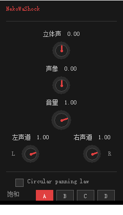

# NekoWaShock

**YOU WA SHOCK 的 64 位版本** —— 一个原生 x64 VST2 插件。

原版 `YOU WA SHOCK !.dll` 是 2007 年的 **Winamp DSP 2.x** 插件（唯一导出 `winampDSPGetHeader2`），
不是 VST，无法在任何 64 位宿主里加载。本项目按原版功能重写为原生 64 位 VST2 插件，
并还原了原有界面布局。



## 功能

| 参数 | 范围 | 默认 | 说明 |
|---|---|---|---|
| Volume | -2 ~ +2 | 1.0 | 总音量，1.0 = 0 dB |
| Panning | -1 ~ +1 | 0 | 平衡式声像，居中不衰减 |
| Sep | -1 ~ +1 | 0 | 立体声分离：+1 加宽，-1 收成单声道 |
| LVolume | -2 ~ +2 | 1.0 | 左声道音量 |
| RVolume | -2 ~ +2 | 1.0 | 右声道音量 |
| CircPan | On / Off | Off | 圆形（等功率）声像律 |
| Satur | A / B / C / D | A | 饱和模式 |

### 饱和模式

对应原版的 `saturation mode` 选项：

- **A** Default —— 直通
- **B** No saturation —— 直通
- **C** Sat A —— 软饱和（drive 1.5×）
- **D** Sat B —— 强饱和（drive 3.0×）

C / D 会给信号加入谐波，让声音更厚。

## 安装

1. 从 [Releases](../../releases) 下载 `NekoWaShock.dll`
2. 放进你的 64 位 VST2 插件目录
3. 让宿主（Vegas Pro / REAPER / FL Studio 等）扫描

插件窗口内的旋钮可上下拖动改值，`Circular panning law` 与 `A B C D` 为点击切换。

## 构建

需要 CMake 3.20+ 与 Visual Studio（MSVC，x64）。

```bash
cmake -S . -B build -A x64
cmake --build build --config Release
```

产物：`build/Release/NekoWaShock.dll`

## 关于原版

原插件的关键信息（逆向所得）：

```
文件      YOU WA SHOCK !.dll
格式      Winamp DSP 2.x（唯一导出 winampDSPGetHeader2）
架构      x86 / PE32
编译器    Delphi（Borland VCL）
加壳      自研壳（代码节虚拟尺寸远大于原始尺寸）
```

确认过的细节：

- 界面内嵌 5 个 `TCircleWheel` 旋钮 + 1 个 `TQuickCheckBox`，控件范围以 1/256 定点存储
- 立体声分离的设计时值被设为最大值 +1，因此 **+1 是加宽**
- 饱和模式字符串依次为 `Default` / `No saturation` / `saturation mode A` / `saturation mode B`

## 与原版的差异

- 原版是模态窗口，点 `Accept` 才生效；本插件实时生效（VST 标准行为）
- 原版界面背景为海报图，本项目用深色背景 + 自绘旋钮还原布局关系
- 饱和曲线由标准软削波（tanh 的 Padé 近似）实现，与原版具体曲线可能有细微听感差异

## 许可

[MIT](LICENSE) © MCNeko-Forum
